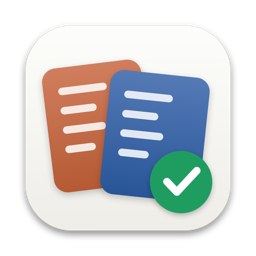
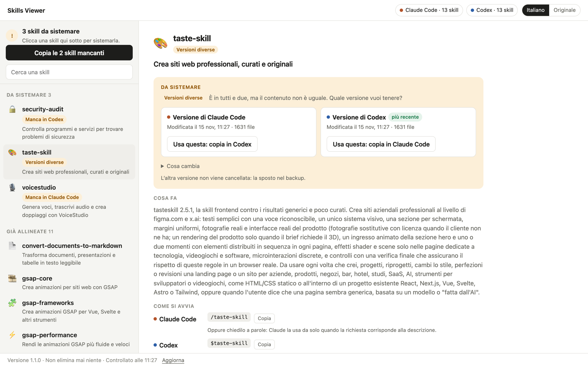
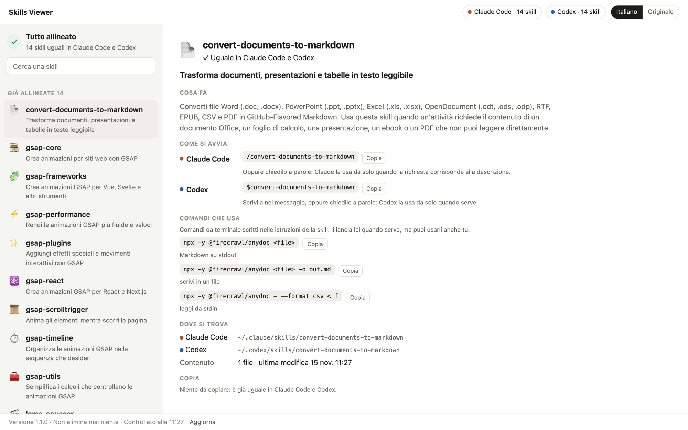
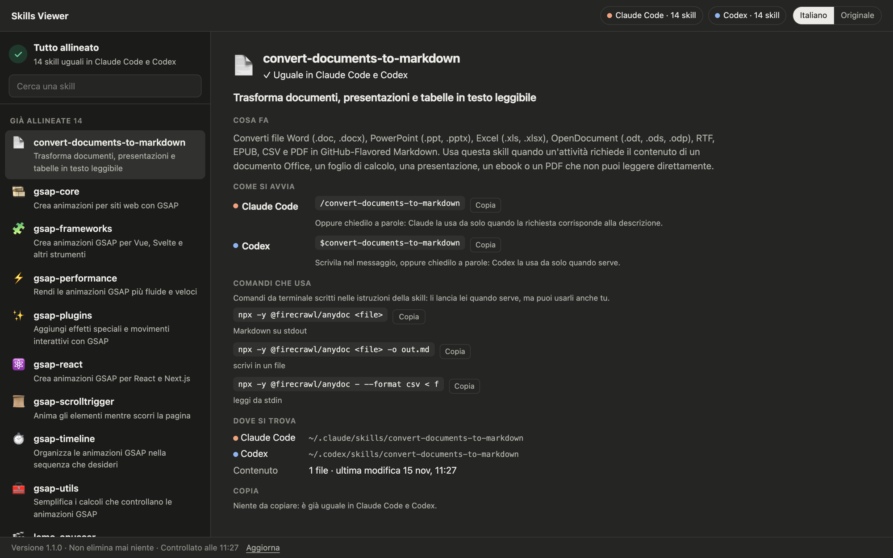
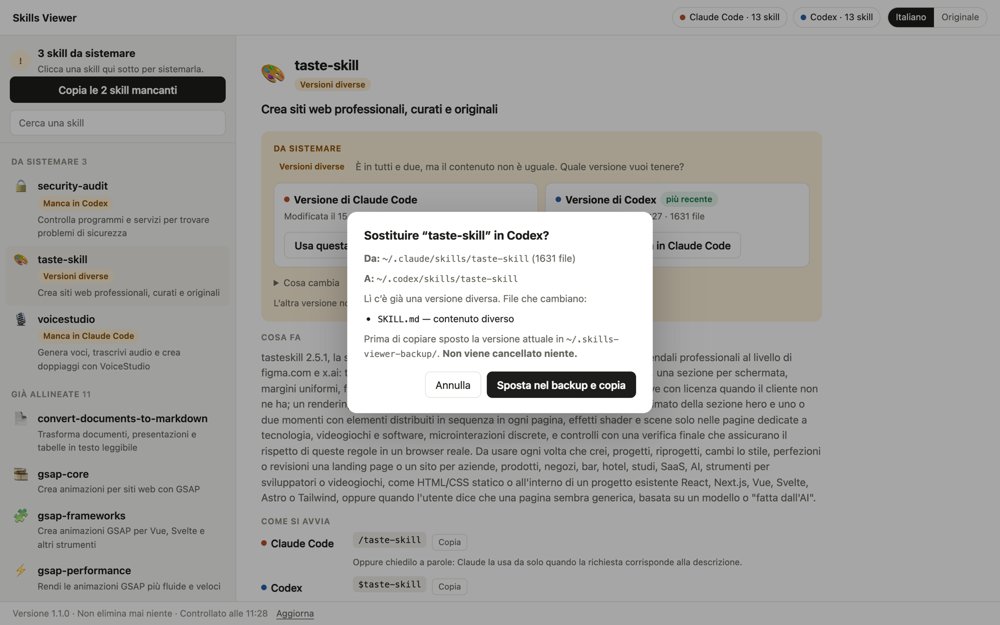
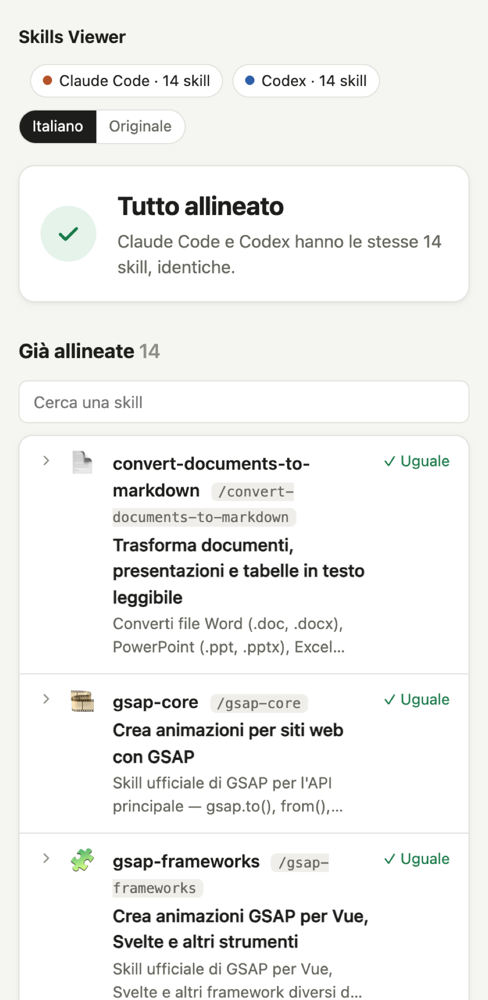

<div align="center">



# Skills Viewer

**Le skill di Claude Code e Codex, sempre allineate.**<br>
Vedi a colpo d'occhio cosa manca e cosa è diverso, e sistemalo con un clic, senza mai perdere niente.


<br>

<picture>
  <source media="(prefers-color-scheme: dark)" srcset="docs/screenshots/da-sistemare-scuro.png">
  
</picture>

</div>

---

## Perché

Claude Code e Codex usano le **skill**: cartelle di istruzioni che insegnano all'assistente a fare qualcosa, come convertire un PDF, animare una pagina o controllare la sicurezza del codice. Ognuno le tiene nella sua cartella:

| | Cartella |
|---|---|
| 🟠 **Claude Code** | `~/.claude/skills` |
| 🔵 **Codex** | `~/.codex/skills` (e `~/.agents/skills`, se esiste) |

Quando installi una skill in uno dei due, l'altro non ne sa niente. Skills Viewer ti mostra le differenze e ti aiuta a tenerli uguali.

## Cosa fa

| | |
|---|---|
| ✅ **Ti dice subito se sono allineate** | In alto vedi "Tutto allineato" oppure "3 skill da sistemare". |
| 🔍 **Mostra cosa non torna** | Skill che ci sono da una parte sola, e skill presenti in tutti e due ma con contenuti diversi, con l'elenco dei file che cambiano. |
| 📋 **Copia con un clic** | "Copia in Codex" e "Copia in Claude Code", sempre dopo una conferma che mostra cosa viene copiato e dove. |
| 🗂️ **Spiega ogni skill** | Cosa fa, quando usarla, come si avvia (`/nome` in Claude Code, `$nome` in Codex), quali comandi usa e quali script contiene. |
| 🇮🇹 **In italiano, con emoji** | Se hai Codex, traduce le descrizioni e dà a ogni skill un'emoji e una frase breve: 📄 *Trasforma documenti in testo leggibile*. |
| 🔄 **Si aggiorna da solo** | Aggiungi, togli o modifichi una skill e la finestra si aggiorna in meno di un secondo. |

<table>
  <tr>
    <td width="50%"></td>
    <td width="50%"></td>
  </tr>
  <tr>
    <td align="center"><sub>Tutto allineato: ogni skill spiegata in parole semplici</sub></td>
    <td align="center"><sub>Segue il tema chiaro o scuro del Mac</sub></td>
  </tr>
</table>

## 🛡️ Non elimina mai niente

Skills Viewer è fatto per non farti perdere niente.



- **Nessuna cancellazione nel codice.** Non ci sono istruzioni che eliminano file o cartelle.
- **Copia solo quando confermi.** Prima di ogni copia ti mostra *da dove*, *a dove* e *cosa cambia*.
- **Non sovrascrive in silenzio.** Se la skill esiste già, prima sposta la versione attuale in `~/.skills-viewer-backup/<data e ora>/` e solo dopo copia. Per tornare indietro basta rimettere al suo posto quella cartella.
- **Resta nelle sue cartelle.** Non scrive altrove, salta `.git` e `node_modules` e non segue collegamenti che portano fuori dalle cartelle delle skill.
- **Accetta comandi solo dalla sua finestra.** Funziona solo su questo computer, e ogni richiesta di copia deve contenere un codice segreto creato a ogni avvio: nessun'altra pagina web può chiedergli di copiare qualcosa.

<br clear="right">

## Requisiti

- Un **Mac**.
- **[Node.js](https://nodejs.org) 18 o più recente.** È gratis: scegli la versione "LTS" e installala come un normale programma. Se manca, Skills Viewer te lo dice all'avvio.
- *Facoltativo:* **Codex** installato e collegato al tuo account, per traduzioni ed emoji. Senza Codex funziona tutto, ma le descrizioni restano in lingua originale.

## Come avviarlo

### Nel browser (il modo più semplice)

1. Scarica il progetto: **Code → Download ZIP** su questa pagina, oppure `git clone`.
2. Fai doppio clic su **`Avvia Skills Viewer.command`**.
3. Si apre una finestra del Terminale (lasciala aperta) e poi Skills Viewer nel browser. Per chiuderlo, chiudi la finestra del Terminale.

### Come app per Mac

Con la sua finestra, la sua icona e i menu. Servono gli strumenti per sviluppatori di Apple (`xcode-select --install`). Poi, nella cartella del progetto:

```bash
./Scripts/build-app.sh
```

L'app compare in `Apps/Skills Viewer.app`: trascinala in **Applicazioni** o nel Dock.



### ⚠️ Avviso di macOS al primo avvio

La prima volta macOS potrebbe dire che il file *"non può essere aperto perché proviene da uno sviluppatore non identificato"*. È normale per i programmi che non arrivano dall'App Store.

1. **Clic destro** (o Ctrl + clic) su `Avvia Skills Viewer.command` o su `Skills Viewer.app`.
2. Scegli **Apri**.
3. Nella finestra che compare, premi di nuovo **Apri**.

Basta farlo una volta sola. Se non vedi il pulsante **Apri**, vai in **Impostazioni di Sistema → Privacy e sicurezza** e premi **Apri comunque**.

### Scorciatoie

| | |
|---|---|
| <kbd>⌘</kbd> <kbd>R</kbd> | Aggiorna |
| <kbd>⌘</kbd> <kbd>F</kbd> | Cerca una skill |
| <kbd>⇧</kbd> <kbd>⌘</kbd> <kbd>A</kbd> | Copia le skill mancanti |
| <kbd>↑</kbd> <kbd>↓</kbd> | Skill precedente o successiva |

<br clear="right">

## Aggiornamenti

Se hai scaricato il progetto con `git clone`, per avere l'ultima versione:

```bash
git pull
```

Se usi l'app per Mac, dopo l'aggiornamento ricompilala con `./Scripts/build-app.sh`. Le novità di ogni versione sono in **[CHANGELOG.md](CHANGELOG.md)**; la versione che stai usando è scritta in fondo alla finestra.

## Cosa scrive sul tuo Mac

Per trasparenza, ecco tutto quello che Skills Viewer può scrivere:

| Dove | Quando |
|---|---|
| `~/.claude/skills`, `~/.codex/skills`, `~/.agents/skills` | Solo quando confermi una copia |
| `~/.skills-viewer-backup/` | Quando una copia sostituisce una versione esistente |
| `~/.skills-viewer/traduzioni.json` | Traduzioni ed emoji, salvate per non doverle rifare |

Tutto il resto viene solo letto.

<details>
<summary><b>Come è fatto</b> (per chi vuole guardare il codice)</summary>

<br>

- **`server.js`**: un piccolo server Node senza dipendenze, che risponde solo su `127.0.0.1`. Legge le cartelle delle skill, confronta i file con un'impronta SHA-256, estrae da `SKILL.md` cosa fa ogni skill e tiene d'occhio le cartelle per gli aggiornamenti automatici. L'unico endpoint che scrive nelle skill è `POST /api/copy`, protetto da controllo di Host e Origin e da un token anti-CSRF.
- **`index.html`**: tutta l'interfaccia, in un solo file senza librerie esterne.
- **`Sources/SkillsViewer/App.swift`**: l'app per Mac, una finestra che avvia `server.js` e ne mostra la pagina.
- **`Avvia Skills Viewer.command`**: avvio nel browser, con il controllo di Node.js.

</details>
